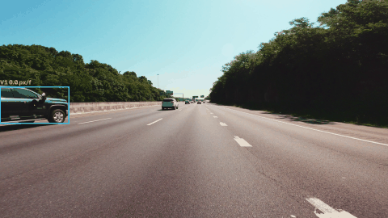

# Classical Vehicle Tracker

A vehicle motion tracker built with classical computer vision (no deep learning). It detects moving vehicles in a traffic video using background subtraction, then tracks their motion frame by frame using Lucas-Kanade sparse optical flow, ORB feature matching or SIFT feature matching.



## What it does

For every frame of the input video, the tracker:

1. Detects moving vehicles with MOG2 background subtraction and draws a bounding box around each one.
2. Finds points to follow inside those boxes only, so the background is not tracked:
   - `lk`: Shi-Tomasi corner features.
   - `orb`: ORB keypoints with binary descriptors.
   - `sift`: SIFT keypoints with floating-point descriptors.
3. Links each point from the previous frame to the current one:
   - `lk`: pyramidal Lucas-Kanade optical flow.
   - `orb`: brute-force descriptor matching with Hamming distance.
   - `sift`: brute-force descriptor matching with L2 distance.
4. Rejects unreliable tracks:
   - `lk`: forward-backward consistency check.
   - `orb` and `sift`: Lowe's ratio test, then RANSAC inside each vehicle box.
5. Estimates each vehicle's displacement as the median motion of the points inside its box, drawn as an arrow with a label in pixels per frame.
6. Draws fading green trails showing recent point motion.

The result for each method is saved as an annotated video, and a short GIF is made from one of them.

## How it works

| Stage | Technique | Purpose |
|---|---|---|
| Vehicle detection | MOG2 background subtractor, morphological open and close, contour area filter | Find moving blobs and turn them into bounding boxes |
| Feature selection (`lk`) | Shi-Tomasi corners (`goodFeaturesToTrack`) restricted to the boxes | Choose points worth tracking on vehicles |
| Feature selection (`orb`, `sift`) | `ORB_create` or `SIFT_create` keypoints and descriptors, restricted to the moving-region mask | Find distinctive points that can be recognised in the next frame |
| Motion tracking (`lk`) | Pyramidal Lucas-Kanade optical flow | Follow each point between consecutive frames |
| Matching (`orb`, `sift`) | `BFMatcher` with Hamming distance (ORB) or L2 norm (SIFT), `knnMatch` with k = 2 | Find the same point in the next frame |
| Outlier rejection (`lk`) | Forward-backward error check (threshold 1.0 px) | Drop points whose flow is not reversible |
| Outlier rejection (`orb`, `sift`) | Lowe's ratio test (0.75), then RANSAC with `estimateAffinePartial2D` (3 px) per vehicle | Drop ambiguous and inconsistent matches |
| Displacement | Median of per-point motion inside each box | A robust per-vehicle motion estimate |

Lucas-Kanade assumes that pixel intensity stays roughly constant and that motion is small within a local window (15 x 15 here, with 2 pyramid levels to handle larger motion). The feature-matching methods do not need small motion, but they need enough distinctive keypoints on each vehicle. RANSAC needs at least 4 matches inside a box before it runs.

## Project structure

```
classical-vehicle-tracker/
    vehicle_tracker.py
    README.md
    requirements.txt
    videos/
        traffic.mp4
    outputs/
        tracked_lk.mp4
        tracked_orb.mp4
        tracked_sift.mp4
        tracking_demo.gif
```

## Setup

Requires Python 3.9 or newer. SIFT needs OpenCV 4.4 or newer.

```
py -m pip install opencv-python numpy imageio imageio-ffmpeg pillow
```

`imageio-ffmpeg` bundles the ffmpeg encoder used to write the H.264 output video, so ffmpeg does not need to be installed separately.

## Usage

Place the input video at `videos/traffic.mp4`, then run:

```
py vehicle_tracker.py
```

This runs the methods listed in `METHODS` one after another and prints a short summary as each one finishes. When it is done, the results are in the `outputs` folder:

- `tracked_lk.mp4`, `tracked_orb.mp4` and `tracked_sift.mp4`: the annotated videos for each method
- `tracking_demo.gif`: a short preview of the Lucas-Kanade run, used in this README

To run fewer methods, edit the `METHODS` list near the top of `vehicle_tracker.py`, for example `METHODS = ["lk"]` for Lucas-Kanade only. It may contain only `"lk"`, `"orb"` and `"sift"`; anything else stops the script with an error message.

The script processes frames at 960 px wide for speed, regardless of the source resolution.

## Outputs

Everything the script produces is saved in the [`outputs`](outputs/) folder:

| File | What it is |
|---|---|
| [`tracking_demo.gif`](outputs/tracking_demo.gif) | About 5.6 s preview of the Lucas-Kanade run, shown at the top of this page |
| [`tracked_lk.mp4`](outputs/tracked_lk.mp4?raw=true) | Full annotated video from the Lucas-Kanade tracker |
| [`tracked_orb.mp4`](outputs/tracked_orb.mp4?raw=true) | Full annotated video from the ORB tracker |
| [`tracked_sift.mp4`](outputs/tracked_sift.mp4?raw=true) | Full annotated video from the SIFT tracker |

GitHub cannot preview MP4 files in its file viewer, so the video links open or download the raw file. The GIF is made from the method set in `GIF_METHOD` (Lucas-Kanade by default), or from the only method in `METHODS` if just one is listed.

## Configuration

Settings are constants at the top of `vehicle_tracker.py`:

| Constant | Default | Effect |
|---|---|---|
| `METHODS` | `["lk", "orb", "sift"]` | Which trackers to run |
| `GIF_METHOD` | `"lk"` | Which method the demo GIF is made from |
| `PROCESS_WIDTH` | 960 | Width frames are resized to before processing |
| `MIN_AREA_RATIO` | 0.0008 | Smallest blob (as a fraction of the frame) counted as a vehicle |
| `TRAIL_FADE` | 0.9 | How quickly the green trails fade (lower fades faster) |
| `RESEED_EVERY` | 5 | `lk`: frames between adding new feature points |
| `FB_THRESHOLD` | 1.0 | `lk`: maximum forward-backward error (pixels) to keep a point |
| `MAX_FEATURES` | 1500 | `orb`, `sift`: maximum keypoints per frame |
| `RATIO_THRESHOLD` | 0.75 | `orb`, `sift`: Lowe's ratio test cutoff (lower is stricter) |
| `RANSAC_THRESHOLD` | 3.0 | `orb`, `sift`: RANSAC inlier distance (pixels) |
| `MIN_MATCHES` | 4 | `orb`, `sift`: matches needed in a box before RANSAC runs |
| `GIF_STEP` / `GIF_WIDTH` / `MAX_GIF_FRAMES` | 4 / 480 / 70 | GIF frame sampling, width, and length |
| `GIF_FRAME_MS` | 80 | Time each GIF frame is shown (milliseconds) |

If vehicles are missed, lower `MIN_AREA_RATIO` or the `varThreshold` value in the MOG2 call. If one vehicle is split into two boxes, raise the closing `iterations` in `vehicle_mask`. If feature matching gives too many wrong matches, lower `RATIO_THRESHOLD` or `RANSAC_THRESHOLD`.

## Limitations

- Assumes a static camera. Camera shake or panning makes the whole background look like motion.
- Detection finds anything that moves, not specifically vehicles, so a pedestrian or cyclist would also get a box.
- Boxes are detected independently in each frame, so vehicles do not keep a persistent ID across frames.
- In dense traffic, MOG2 can split one large vehicle into two boxes or merge two close vehicles into one.
- Vehicles that stop for a long time are gradually absorbed into the background and stop being detected.
- Small or distant vehicles have few distinctive keypoints, so ORB and SIFT matching are less reliable on them.
- Displacement is reported in pixels per frame, not real-world speed. Converting to km/h would need camera calibration.

## Related techniques

The three trackers share the same detection stage, so their output can be compared directly. Lucas-Kanade is the fastest because it follows a small set of corner points. ORB uses compact binary descriptors, which are fast to compute and compare. SIFT uses larger floating-point descriptors that are more robust to scale and rotation changes but slower to compute and match. On the test clip the full 699 frames took about 52 s for Lucas-Kanade, 74 s for ORB and 148 s for SIFT; times will differ on other machines.

## Tools

Python, OpenCV, NumPy, imageio, Pillow.
